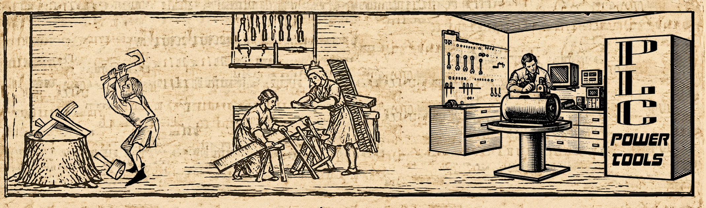

# PLC Power Tools

**Free classroom tools that run right in your browser.**
*Simple. Efficient. Take back your time.*

---

> *Stop trying to do everything by hand. You can't turn single teachers into whole factories.*

## 📖 About

Hi, I'm Ryan Graham. I teach Biology at College Park High School. I built these tools **by a teacher, for teachers**, to help my PLC do less admin busywork and spend more time **actually teaching**.

I wanted to streamline the way we review assessment data and to better accommodate our ever-growing, diverse student populations.

> **They don't pay teachers enough to be data analysts too!**

## 🧰 The Tools

Each tool lives on the live site, with its current version and change notes shown on its card.

👉 **[Browse all tools](https://p4intsplatter.github.io/PLCPowertools/#tools)**

<!-- Add your tools below. Copy this row for each one. -->

| Tool | What it does | Version |
|------|--------------|---------|
| **Tool name** | One-line description of what it does | `v1.0` |
| **Tool name** | One-line description of what it does | `v1.0` |

<!-- Optional: add a screenshot of a tool.

  

-->

## 🎯 Who Are These For?

These tools are designed around a workflow that uses:

- **Eduphoria**
- **PowerSchool Teacher Access Center (TAC)**

They have **not** been tested with exports from other testing or grading platforms. I'll update the tools as feedback comes in.

## 🚀 Getting Started

1. Go to the **[live site](https://p4intsplatter.github.io/PLCPowertools/)**.
2. Click **Open tool** on the tool you want.
3. Load your files by following the steps the tool asks for. Most steps have a built-in help button.

That's it. You'll get the hang of it quickly.

### 💾 Use Offline

Every tool has a **Download** button so you can keep a copy that works without internet.

> A saved copy won't update itself. If something stops working, check the site for a newer version.

## 🛠️ Troubleshooting

- Use the current version of **Chrome**, **Edge**, or **Firefox**.
- Still stuck, or want a change? Use the **[feedback form](https://p4intsplatter.github.io/PLCPowertools/feedback.html)** and I'll try to fix it. 😊

## 🔒 Privacy & FERPA

**Every tool runs entirely in your own browser, using the local cache.**

- Nothing personal or student-related is stored on the site.
- Student data and saved settings stay on your computer and are **never uploaded or sent anywhere**.
- On a public computer, clear the browser and fully log out when you're done.
- Anonymous page-usage statistics are tracked for research purposes.

## 📄 License & Usage

© Ryan Graham, 2026. All tools are free to use, but please **do not mass distribute without explicit permission.**

---

*PLC Power Tools · Work smarter, not harder.*

